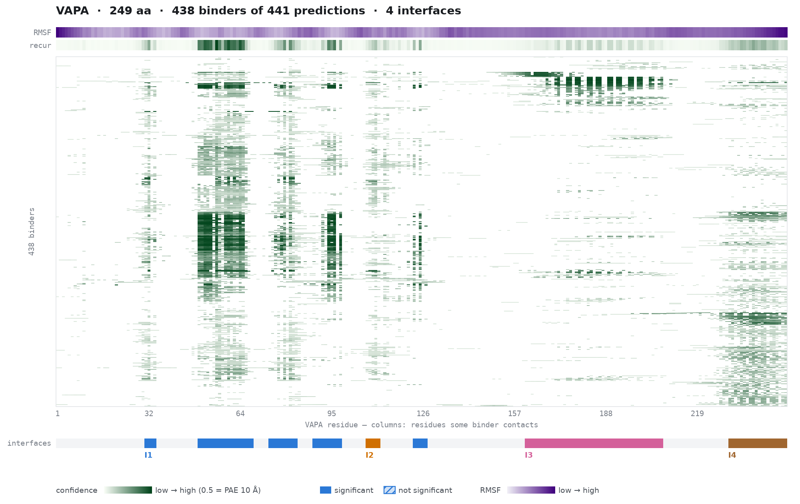
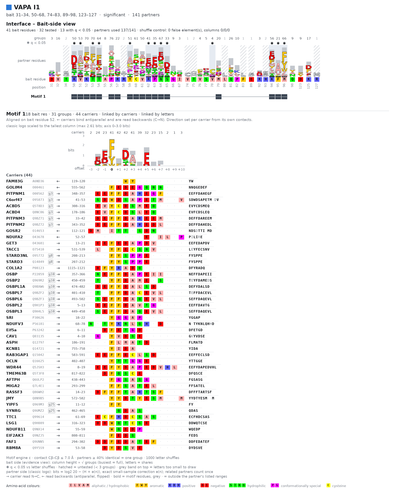

# SCRIMS — statistical inference of functional interaction sites and shared motifs from structure-prediction screens

SCRIMS takes a structure-prediction screen: one **bait** protein predicted
against many partners. It reports:

- the bait's interaction sites, grouped into 3-D interfaces;
- the partners that bind each interface;
- the sequence motifs that unrelated partners share at an interface.

Everything is computed from predicted aligned error (PAE). The method, its
statistics and its validation are described in the accompanying paper (in
preparation). This README covers how to run it.

## Install

    git clone https://github.com/PDB-REDO/SCRIMS
    cd SCRIMS
    conda env create -f environment.yml     # Python deps, mkdssp, pytest
    conda activate scrims
    pip install -e ".[zst]"                 # [zst] reads .zst AFDB files

To use your own environment instead, run `pip install -e ".[zst]"` there. You
need Python with `scipy >= 1.11` and DSSP 4.x on the PATH
(`conda install -c conda-forge dssp`).

## Run

    scrims run path/to/screen -o out/

Then open `out/report.html` in a browser; it works offline.

### What a screen directory looks like

A screen is one folder holding one prediction per partner, all sharing the
same bait. SCRIMS finds the bait itself: it is the chain whose sequence appears
in every prediction.

| Predictor | Files per prediction |
|---|---|
| AlphaFold3 (server or local) | `<pred>/<pred>_model.cif` + `<pred>_confidences.json` |
| AlphaFold2 / ColabFold, AFDB packaging | `<id>-model_v1.cif[.zst]` + `<id>-predicted_aligned_error_v1.json[.zst]` |

Other layouts (`run_alphafold.py` pickles, `colabfold_batch` PDB + JSON) are
not read yet.

### Common runs

    # default: PAE confidence, motif engine with the DSSP null
    scrims run screen/ -o out/

    # faster: motif null without secondary structure (no mkdssp needed)
    scrims run screen/ -o out/ --motif-ss none

    # sites, interfaces and partners only; skip the motif stage
    scrims run screen/ -o out/ --motif-engine none

    # add known-motif (ELM) suggestions: give the bait's Pfam/InterPro domains
    scrims run screen/ -o out/ --bait-domains PF00635,IPR000535

    # one pair, or two sequences shared by every prediction: name the bait chain
    scrims run pair/ -o out/ --bait-chain A

    # vector figures, or no figures
    scrims run screen/ -o out/ --figure-format pdf
    scrims run screen/ -o out/ --no-figure

    # several baits: one screen folder each
    for s in screens/*/; do scrims run "$s" -o "results/$(basename "$s")"; done

Every analysis parameter is also a flag (`scrims run --help`). The defaults are
the validated settings; see the paper before changing them.

**Runtime.** Each run uses one core. Most of the time goes to `mkdssp`.
- a 24-prediction screen with `--motif-ss none`: about 15 s;
- a 216-prediction screen with the default DSSP null: about 6 min;
- the 441-prediction VAPA example below with the default DSSP null: about 13 min.

### Optional inputs

- **Foldseek 3Di** (`--motif-engine 3di_aa`): compares partner residues by amino
  acid plus 3Di state. Needs Foldseek: `conda install -c bioconda foldseek`, or
  `--foldseek-bin` / `$SCRIMS_FOLDSEEK`.
- **AlphaBridge** (`--source alphabridge`, AlphaFold3 only): reads
  [AlphaBridge](https://github.com/PDB-REDO/AlphaBridge) output instead of PAE.
  AlphaBridge is a separate tool with its own licence, and it is not needed for
  the default run. Run it on every prediction first:

      for d in screen/*/; do python3 define_interfaces.py -i "$d"; done
      scrims run screen/ -o out/ --source alphabridge

## Example: VAPA

The screen from the paper: VAPA against 441 partners from the NVIDIA
heterodimer set (AlphaFold-Multimer via ColabFold, AFDB packaging):

    scrims run VAPA_screen/ -o VAPA_out/ --bait-domains PF00635,IPR000535

The printed summary:

    [source: pae] 441 predictions -> 8 sites (8 significant) in 4 interfaces, 2 motifs (engine c, null dssp)

**`overview.png`** is the confidence matrix: one row per partner, one column
per VAPA residue. The tracks above it show the bait's RMSF and the recurrence
signal; the lane below shows the called interfaces.



**`interfaces/I1.png`** shows one interface. Bait-side letters at the top mark
which partner residues sit on each bait residue (* = significant). Below are the
motif lanes and, for each motif, a partner-sequence logo with its carriers. Here
it shows the FFAT-like motif on the MSP domain.



`report.html` shows the same views interactively, with linked selection.

## Outputs

| file | what |
|---|---|
| `report.html` | interactive page: matrix, interfaces, partners, motifs |
| `overview.png`, `matrix.png` | the confidence matrix with tracks and interfaces |
| `interfaces/<I>.png`, `interfaces/<I>_partners.png` | per interface: motif figure; partner list |
| `scrims.cxc` (+ `models/`) | ChimeraX script colouring interfaces and motif residues; run it from the output folder: `cd out && chimerax scrims.cxc` |
| `sites.tsv`, `interfaces.tsv`, `partners.tsv`, `bait_side.tsv`, `motifs.tsv` | tables |
| `scrims.json` | everything in one versioned document (schema `scrims/1`) |
| `matrix.npz`, `summary.json` | raw matrices; parameters, counts, skipped predictions |

Check `summary.json` for predictions that were skipped. With a single
prediction, SCRIMS reports the matrix and strength regions but no q-values.

## From Python

```python
from scrims import analyze
res = analyze("path/to/screen")
res.M_pae, res.M_signal          # partners × bait residues (NaN / 0 = no contact)
res.sites, res.interfaces        # called sites; 3-D interfaces
res.partners, res.motifs         # partners per interface; motif engine output
```

## Tests

    pytest                # synthetic screen, no data needed
    pytest --run-slow     # + three real AlphaFold3 screens in data/ (not in git; ~6 min)

## Licence

[CC BY-NC 4.0](LICENSE): free for non-commercial use. SCRIMS contains no
AlphaBridge code. If you use AlphaBridge output, AlphaBridge's own licence and
citation terms apply.
